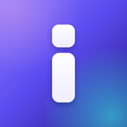
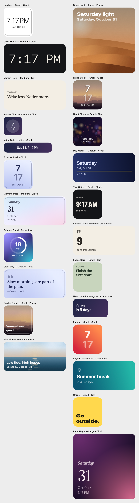

# Infly

Beautiful iPhone widgets, made yours in a minute. Pick a style, customize it with a live preview, save it, then add the Infly widget to your Home Screen or Lock Screen and choose your design.

Swift, SwiftUI and WidgetKit. No accounts, analytics, network access or third-party dependencies.



## Status

| | |
|---|---|
| Xcode project (app, widget extension, unit tests) | Done |
| Built with Xcode 26.6 (iOS 26.5 SDK) | Yes, on GitHub Actions: build succeeded with 0 warnings |
| Unit tests | 17 of 17 pass, on an iPhone simulator in the cloud |
| `.ipa` | Built in the cloud and ad-hoc signed. Install it with Sideloadly (see [Install with Sideloadly](#install-with-sideloadly)) |
| Mac app | Built in the cloud with Mac Catalyst, ad-hoc signed (see [Install on a Mac](#install-on-a-mac)) |
| Run on a real iPhone or Mac | Not yet verified |

## Requirements

- **Xcode 26 or later** for the Liquid Glass look. Xcode 16.x also builds the project; the glass code is behind `#if compiler(>=6.2)`, so older Xcodes get the material fallback.
- **iOS 18.0 or later.** iOS 18 is the earliest version that has everything Infly uses:
  - `Text(.currentDate, format:)` keeps custom clock formats live in widgets without a timeline entry every minute.
  - `AppIntentConfiguration` (iOS 17) lets each widget pick a saved design.
  - `widgetAccentedRenderingMode` (iOS 18) keeps photos right on tinted and Clear Home Screens.
  - The `Tab` API and zoom transitions are iOS 18.

  iOS 18 runs on every iPhone that iOS 17 supports (XS / XR and later).
- **iOS 26 and later** get Liquid Glass (`glassEffect`, `.glass` and `.glassProminent` button styles, a tab bar that minimizes on scroll). iOS 18 uses materials with hairline edges instead.
- iPhone (portrait), plus a Mac app built with Mac Catalyst (macOS 15 or later).

## Set up and run

1. Open `Config/Infly.xcconfig` and set your values:
   ```
   INFLY_BUNDLE_ID_PREFIX = com.yourname
   DEVELOPMENT_TEAM = ABCDE12345
   ```
   Every bundle ID and the App Group (`group.<prefix>.infly`) derive from these, through the entitlements and both Info.plists.
2. Open `Infly.xcodeproj` in Xcode.
3. Choose the **Infly** scheme and an iPhone simulator or device, then press Run.
4. Signing is automatic. If Xcode doesn't register the App Group for you, open **Signing & Capabilities** for both the **Infly** and **InflyWidgetsExtension** targets and add `group.<prefix>.infly` under App Groups.

To try the widget, run the app, save a design, then go to the Home Screen: touch and hold → **Edit** → **Add Widget** → **Infly**. To debug the extension itself, choose the **InflyWidgetsExtension** scheme. If Xcode didn't create one, add it with **Product → Scheme → New Scheme**.

## Tests

In Xcode, press **⌘U**. From the command line, using any installed iPhone simulator:

```bash
xcodebuild test -project Infly.xcodeproj -scheme Infly -destination 'platform=iOS Simulator,name=iPhone 17'
```

`InflyTests/InflyTests.swift` uses Swift Testing. It covers:

- Save and reload across launches, and edit in place.
- **The widget extension's reader sees what the app saved.** It uses the same `DesignStore.read(from:)` the extension calls.
- Duplicate, rename (empty names rejected) and delete.
- Repeated names get numbered.
- A photo shared by duplicates survives until no design uses it.
- A missing photo is reported, not fatal, and stored photos are downsized.
- An unreadable data file is set aside, never overwritten.
- Undo, redo and Reset to Preset.
- Countdown day math across a daylight-saving change.
- Timeline refresh dates.
- Crop math always covers the widget.
- Automatic text color picks the readable choice.
- Preset integrity.
- Widget size lookup.
- The App Group is read from the signing profile, as after re-signing.

Things to check by hand on a device: adding Home and Lock Screen widgets, choosing a design in **Edit Widget**, tapping a widget to open its design, deleting a design that's on the Home Screen (the widget shows "Design deleted"), picking a photo while offline, and Dark Mode, tinted and Clear Home Screens, larger text, Reduce Motion and Reduce Transparency.

## Downloads, without Xcode

Both apps are on the repo's **latest** release: https://github.com/leopoldobruzuall-ai/Infly/releases/tag/latest

- `Infly.ipa` is for iPhone.
- `Infly-mac.zip` is the Mac app.

The repo is private, so sign in to GitHub to download.

`.github/workflows/build-ipa.yml` (**Build apps**) builds both on a GitHub-hosted Mac. It runs on every push to `main` (README and `docs/` changes are skipped) and from **Actions → Build apps → Run workflow**. Each run:

1. Builds for iPhone with the newest Xcode on the runner, unsigned, and ad-hoc signs it with the App Group entitlement so re-signing tools keep it.
2. Builds the Mac app with Mac Catalyst, unsigned, and ad-hoc signs it with the sandbox entitlement that Mac widget extensions need.
3. Replaces the **latest** release's files, and also uploads them as run artifacts, kept for 14 days.
4. Runs the unit tests on an iPhone simulator.

Bundle IDs come from `BUNDLE_PREFIX` at the top of the workflow (currently `com.leobruzual`). To download from the command line:

```bash
gh release download latest --repo leopoldobruzuall-ai/Infly -D build --clobber
```

## Install on a Mac

Needs macOS 15 or later, on Apple Silicon or Intel.

1. Download `Infly-mac.zip` from the latest release, unzip it, and drag **Infly** into **Applications**.
2. Open it once. macOS blocks apps that aren't notarized, so go to **System Settings → Privacy & Security** and click **Open Anyway**.
3. **Widgets:**
   1. Right-click an empty part of the desktop and choose **Edit Widgets**.
   2. Search for **Infly** and drag a size onto the desktop.
   3. Right-click the widget, choose **Edit "Infly"**, and paste into **Design Code**. Get a code with **Copy Widget Code** in a design's menu.

Unsigned Mac builds can't be granted an App Group, so Mac widgets always use design codes. If Infly doesn't appear in the widget gallery, macOS may want a signed build. Alternatively, with Infly on your iPhone, turn on **System Settings → Desktop & Dock → Use iPhone widgets** and add Infly's iPhone widgets to the Mac desktop.

## Install with Sideloadly

1. Connect your iPhone, open Sideloadly, drag in `build/Infly.ipa`, enter your Apple ID, and click **Start**. Sideloadly signs the app and its widget with your Apple ID.
2. On the iPhone, open **Settings → Privacy & Security → Developer Mode** and turn it on if asked. The iPhone restarts.
3. In **Settings → General → VPN & Device Management**, trust your Apple ID's developer profile.
4. Open Infly, save a design, then add the Infly widget from the Home Screen.

With a free Apple ID, the install expires after 7 days, and you can re-sideload to renew it.

**Widgets without an App Group.** Free Apple IDs usually can't grant App Groups, so widgets can't read Infly's storage. Infly shows a red note in Settings when that happens. Use widget codes instead:

1. In Infly, open a design's ••• menu (or the editor's title menu) and choose **Copy Widget Code**.
2. Touch and hold the widget, choose **Edit Widget**, and paste into **Design Code**.

The widget then draws the design from the code alone. Sample photos work; photos you pick yourself need the App Group. When the App Group is available, Infly reads it from the profile it was signed with, even if the signing tool renamed it.

## Build an .ipa with Xcode

With a paid Apple Developer team set in `Config/Infly.xcconfig`:

**In Xcode:** **Product → Archive**, then **Distribute App** and choose Debugging (your registered devices), Release Testing (Ad Hoc), or App Store Connect.

**From the command line:**

```bash
xcodebuild archive -project Infly.xcodeproj -scheme Infly -destination 'generic/platform=iOS' -archivePath build/Infly.xcarchive -allowProvisioningUpdates
```

```bash
xcodebuild -exportArchive -archivePath build/Infly.xcarchive -exportOptionsPlist Config/ExportOptions.plist -exportPath build -allowProvisioningUpdates
```

`Config/ExportOptions.plist` uses `debugging`. Change `method` to `release-testing` or `app-store-connect` as needed. Never put certificates, passwords or API keys in the project; Xcode reads signing from your keychain and Apple account.

## How this was verified

The development Mac has no Xcode, only the Command Line Tools. So the project was checked two ways.

**In the cloud, with real Xcode:**

- Xcode 26.6 built the app and widget for iPhone with 0 warnings.
- The App Intents metadata (both design pickers) and the compiled asset catalogs are in the IPA.
- All 17 unit tests passed on an iPhone simulator.

**Locally, with the Mac Catalyst SDK**, which exposes the iOS UIKit / SwiftUI / WidgetKit / App Intents APIs:

- **Typecheck.** Both targets typecheck against `arm64-apple-ios18.0-macabi` with zero errors and zero warnings.
- **Unit tests.** The real test file ran against the real sources: 17 of 17 passed.
- **Renders.** Every preset at every size was rendered to PNG through the same `WidgetCanvas` / `DesignView` code the widget uses (the images in `docs/`).
- **Smoke runs.** The app was built as a Catalyst app and launched into every tab, every editor type and section, the add-widget guide, and first-launch onboarding: 19 paths, no crashes.

  These runs caught a real crash, now fixed. A view that hosts an `.alert`, a `.confirmationDialog` or a paged `TabView` and also reads an `@Observable` object with `@Environment` crashes when presented. So the store and router are shared instances (`DesignStore.shared`, `Router.shared`) rather than environment objects.

**Not verified yet:**

- Running on a real iPhone, including a real widget on a real Home Screen.
- The Liquid Glass look on iOS 26 (it compiles, but nobody has looked at it).
- Signing with a paid team, and how Sideloadly handles the App Group.

## Architecture

```
Infly/            App target: SwiftUI screens
  InflyApp.swift      App, Router (tabs, editor, follow-up sheets), RootView, toast
  DesignSystem/       Spacing and radius tokens, glass and card surfaces, chips, previews, brand mark
  Features/           Discover, Library (My Widgets), Editor, Onboarding, Settings
InflyWidgets/     Widget extension: Home Screen and Lock Screen widgets, intents, timeline provider
Shared/           Compiled into both targets
  Model/              WidgetDesign (Codable), presets, palettes, collections
  Storage/            DesignStore (JSON in the App Group), PhotoFiles (ImageIO), crop math
  Rendering/          DesignView, DesignBackground, WidgetCanvas, widget sizes, timeline plan
  Samples/            Four sample photos (bundled in both targets)
InflyTests/       Swift Testing unit tests
Config/           xcconfig, entitlements, Info.plists, export options
Tools/            GenerateArt.swift draws the app icon and sample photos (swift Tools/GenerateArt.swift)
```

**One renderer.** `DesignView` draws every design: in-app previews, the Discover gallery, the editor, and the real widget. The widget disables WidgetKit's content margins and applies each design's own padding, so previews match the widget exactly. Previews are drawn at the real widget size for the device's screen class (from Apple's size table), then scaled down to fit.

**Shared data.** Designs are one JSON file in the App Group container, written atomically. The extension only reads it. Each save calls `WidgetCenter.reloadAllTimelines()`. Photos are downsized to 2048 px with ImageIO, stored as JPEG next to the JSON, and removed only when no design references them. The widget decodes photos at just the size it needs, so it stays well inside the extension's memory limit.

**Choosing a design.** The Home Screen and Lock Screen widgets each have an App Intent with a design parameter. Their queries list only designs made for that placement, newest first. An unconfigured widget shows the most recent design.

**Refreshing.** Times use `Text(.currentDate, format:)`, which iOS redraws on its own. Timelines add entries only where content changes: midnight, plus each midnight and the event moment for countdowns. Timelines reload at the end.

**Liquid Glass, used sparingly.** On iOS 26, glass is reserved for floating controls: the editor's size, appearance and history controls, onboarding buttons, and toasts. Tab bars, toolbars and sheets adopt it automatically. Content cards use frosted material. With Reduce Transparency or the in-app Solid Panels setting, both become opaque.

**Accessibility.** Supported:

- Dynamic Type: semantic fonts, and a one-column grid at accessibility sizes.
- VoiceOver labels and custom actions (Rename, Duplicate, Delete) on cards.
- Reduce Motion: from iOS, or Infly's own switch. Turns off zoom transitions and animations.
- Reduce Transparency.
- Increase Contrast: stronger card edges.
- Haptics can be turned off.

## Features

- **Discover.** Four featured collections and 23 original presets, filtered by Minimal, Glass, Photography, Productivity and Color. Search, type and size filters. Every card is a true preview; tapping one zooms into the editor.
- **My Widgets.** Newest-edited first. Type chips and a size filter. Edit, rename, duplicate and delete, with confirmation for deletes. An empty state that offers "Create your first widget".
- **Editor.** Large live preview with a size picker (Home and Lock Screen), a Light/Dark preview for adaptive designs, and undo/redo. Content / Style / Layout sections, one-tap palettes, and Reset to Preset (keeps your words, photo and dates). Cancel asks before discarding changes.
- **Widget types:**
  - **Clock:** Classic, Stacked, Editorial, Minimal and Day progress layouts, with any time zone and a label.
  - **Photo:** crop by dragging and pinching, or with sliders; caption, date, shade and filters.
  - **Text and quote:** Plain, Quote, Note and Headline.
  - **Countdown:** Number, Ring and Sentence layouts, an optional exact time, and a symbol.

  Any widget can use a solid, gradient, aurora or photo background.
- **Lock Screen.** Circular, rectangular and inline versions of clock, countdown and text widgets. Photos aren't offered there because iOS tints the Lock Screen to one color.
- **Onboarding.** Three short pages, a starting style, a guided first edit, and step-by-step add-to-screen instructions after the first save.
- **Settings.** Theme, haptics, solid panels, reduce motion, how to add widgets, refresh widgets, privacy, and "Show Welcome Again".

## Known limitations

- iOS has no API for widget sizes, so previews use Apple's published table and pick the nearest screen class. Newer devices may differ by a few points.
- Widgets can't blur the wallpaper. Glass-style presets suggest depth with gradients, a sheen and a fine edge. On iOS 26, the Clear Home Screen look makes every widget real glass, and Infly's widgets adapt to it.
- The Lock Screen ignores colors and backgrounds, so the editor hides those controls for Lock Screen sizes.
- Clock times update through the system and can lag by a few seconds. Seconds can't be shown.
- App Groups need a signing team that can register them. Without the App Group, the app still works, but widgets show "Open Infly" and Settings shows a warning.
- English only. On iPhone, portrait only. No iPad layouts. The Mac app uses the iPad-style Catalyst interface and has no Lock Screen widgets.
- Photos stored only in iCloud may fail to load offline. Infly then explains and asks for another photo.

## Future work

These were checked against the platform but not built:

- **Calendar "Up Next".** Needs EventKit full access (`NSCalendarsFullAccessUsageDescription`), requested only when that widget is created.
- **Battery.** `UIDevice` battery level is readable in the extension, but the widget refresh budget makes the value stale between reloads.
- **Weather.** Needs WeatherKit, which requires a paid membership and a capability, plus network and location permission. That conflicts with Infly's offline, on-device design, so it's left out.
- **Interactive widgets.** For example, "next quote" with App Intent buttons (iOS 17+).
- An Icon Composer `.icon` for a layered Liquid Glass app icon, iPad layouts, localization, and photo shuffles.
